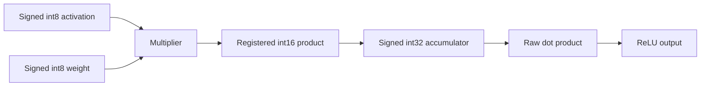

# FPGA Streaming MAC Accelerator

A signed, fixed-point multiply–accumulate datapath for neural-network dot products. This repository preserves the recovered 2025 student FPGA design and adds a separately identified 2026 streaming redesign.

## Architecture



The streaming RTL accepts one pair each clock; the accumulator consumes the previous pair simultaneously. `in_last` marks the last pair of a dot product. After the final product is accumulated, the result is latched and the internal accumulator clears for the next vector. Bubbles and consecutive vectors are supported. There is no output backpressure: the consumer must sample every asserted `out_valid` cycle. The result is retained until another result is published; `out_relu` is valid with `out_valid`.

| Feature | Recovered 2025 design | 2026 streaming redesign |
|---|---|---|
| Arithmetic | Signed 8-bit operands, 32-bit accumulator | Signed 8-bit operands, 16-bit product, 32-bit accumulator (defaults) |
| Scheduling | Alternating multiply / accumulate FSM states | Overlapping registered multiplier and accumulator |
| Input rate | One pair per two compute cycles | One pair per clock, when valid |
| Dot-product length | Three operands by default | Variable, marked by `in_last` |
| Output | ReLU then lower 4 bits for display | Full signed sum and full-width ReLU |
| Hardware validation | Original implementation files recovered; old reports unavailable | Not yet synthesized, simulated or deployed in this environment |

Cycle-rate claims are architectural, not measured timing or achieved clock frequency. For a stream of N uninterrupted operands, output is produced one clock after the final input sampling edge (N+1 sampled edges including the first input and output). Reset is synchronous and aborts in-flight data. `ACC_W` must be at least `2*DW`; the caller must ensure accumulation does not overflow. The default width safely accommodates 784 signed int8 products.

## Repository layout

- `legacy/ml_accelerator.v`: recovered original RTL, reformatted without intentional logic changes.
- `constraints/legacy_board.xdc`: recovered pinout and 10 ns clock constraint; **legacy top only**.
- `rtl/streaming_mac.sv`: new synthesizable streaming datapath.
- `sim/`: self-checking SystemVerilog testbench and Icarus simulation command.
- `python/digits_demo.py`: optional software classifier, quantization and reference-vector export.
- `docs/board_plan.md`: board bring-up and MNIST extension plan.
- `.github/workflows/sim.yml`: CI configuration for RTL simulation (not yet run).

## RTL simulation

With Icarus Verilog and `vvp` installed on Linux or WSL:

```bash
bash sim/run.sh
```

The testbench is designed to check 27 completed dot products, including signed extremes, ReLU, valid gaps, adjacent vectors, randomized vectors, 784-term vectors, reset cancellation and exact output timing. The waveform is written to `build/streaming_mac.vcd`. Open it using GTKWave or use the simulator in Vivado with `tb_streaming_mac` as simulation top.

**Status:** Icarus Verilog, Vivado and other HDL simulators were not available in the packaging environment. This testbench has not been executed there; no simulation-pass claim is made. CI is supplied to execute it after upload.

## Optional digit-classification experiment

The first demonstration uses the small scikit-learn 8×8 handwritten digits dataset, not MNIST. A multiclass linear classifier is trained on a stratified 75% split. Activations and weights are quantized to signed int8 and dot products evaluated in wide integer software; integer biases are added before argmax. No ReLU is applied to the final class logits.

```bash
python -m pip install -r requirements.txt
python python/digits_demo.py
```

Recorded software run (seed 42, 450 test samples, 64 features):

| Model | Test accuracy |
|---|---:|
| Floating-point logistic regression | 96.22% |
| Int8 weights/activations, integer arithmetic | 96.22% |

These are newly measured **software** results, not FPGA throughput or hardware inference results. The script exports class-major weights, one input, biases and expected dot products/logits as hexadecimal files plus an NPZ archive. The exports can be used to compare a future hardware run against the software reference. No model checkpoint or dataset is bundled.

## Hardware notes and provenance

The archived XDC is not verified against the exact board or FPGA part. Do not program a board until its pinout, voltage standards, clock and part number have been confirmed. The legacy design has a fixed two-bit write address, no input-memory initialization, no button debouncing, and a four-bit truncating display. Its constant `always @(*)` anode block can also fail to trigger in simulation. These are preserved as historical limitations rather than silently changed. The new core intentionally has no board-specific interface.

The legacy project dates to 2025; the streaming redesign, testbench and digit software demo were added during the November 2026 repository recovery with AI assistance. Original Vivado project, synthesis reports, timing and waveform records were not recovered. No FPGA resource, power, clock-frequency or hardware-accuracy claim is made for the redesign.
